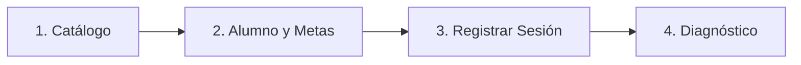

# TutorMemory: Sistema Pedagógico Local

Aplicación local para clases particulares. 0% dependencias de LLMs externos. Diagnóstico determinista por recencia temporal, detección de lagunas, alertas de examen y puente ML clásico (Scikit-learn).

---

## 1. Requisitos Previos

- **Python 3.11+**
- **Node.js 18+** y **npm**
- **Git** (opcional)

---

## 2. Instalación de Dependencias

### Backend (Python)
Desde la raíz del proyecto:
```powershell
# Crear entorno virtual si no existe
python -m venv .venv

# Activar entorno
.venv\Scripts\Activate.ps1    # PowerShell (Windows)
# source .venv/bin/activate   # Linux / macOS

# Instalar backend en modo editable con dependencias
pip install -e backend
```

### Frontend (React + Vite)
```powershell
cd frontend
npm install
cd ..
```

---

## 3. Cómo Arrancar la Aplicación

### Opción Rápida (Recomendada)
Ejecuta el script unificado que levanta backend y frontend a la vez:

En Windows (PowerShell):
```powershell
.\run.ps1
```

### Opción Manual (Dos terminales)
**Terminal 1 (Backend):**
```powershell
$env:PYTHONPATH = "backend/src"
.venv\Scripts\python.exe -m uvicorn tutoring.presentation.api.main:app --host 127.0.0.1 --port 8000 --reload
```

**Terminal 2 (Frontend):**
```powershell
cd frontend
npm run dev
```

### URLs de Acceso
- **Interfaz Web:** [http://localhost:5173](http://localhost:5173)
- **API Swagger / Documentación:** [http://127.0.0.1:8000/docs](http://127.0.0.1:8000/docs)
- **Base de datos:** `tutoring.sqlite3` se crea automáticamente en la raíz.

---

## 4. Flujo de Uso Recomendado



### Paso 1: Configurar Catálogo (Pestaña "Catálogo")
- Crear materias por nivel si tienes varios cursos (ej: `Matemáticas - 2º ESO`, `Física - 1º Bach`).
- Añadir temas (`Álgebra`, `Cinemática`).
- Añadir tipos de ejercicio (`Ecuaciones 1er grado`, `MRUA`).
- *Nota:* El catálogo se construye sobre la marcha según avances con cada alumno.

### Paso 2: Alta de Alumnos (Pestaña "Alumnos")
- Registrar alumno con nombre y email.
- Dentro de la ficha del alumno, pulsar **Fijar Meta de Examen**: indicar materia, fecha del examen y nota objetivo (ej: `8.5`).

### Paso 3: Registrar Sesión (Pestaña "Registrar Sesión")
- Tras cada clase de 1 hora, registrar los ejercicios resueltos.
- Por cada ejercicio indicar:
  - Tipo de ejercicio y tema.
  - Resultado: `Éxito`, `Éxito Parcial` o `Fallo`.
  - Nivel de asistencia del profesor: `Ninguna`, `Pista`, `Paso a paso` o `Resuelto por tutor`.
  - Duración en segundos.
- Guardar sesión.

### Paso 4: Consultar Diagnóstico (Ficha del Alumno)
El motor pedagógico evalúa automáticamente los datos en tiempo real:
- **Score ponderado por recencia (0 a 10):** Lo reciente pesa más que lo antiguo. La ayuda del tutor reduce la ponderación.
- **Alertas de examen:** Avisa en rojo (`CRITICAL`) si quedan menos de 14 días y el score está por debajo de la meta.
- **Ejercicios débiles:** Lista priorizada de ejercicios donde el alumno falla o pide asistencia constante.
- **Tendencia de aprendizaje:** Indica si el alumno mejora (`RISING`), se estanca (`STABLE`) o retrocede (`REGRESSING`).

---

## 5. Pruebas Automatizadas

### Backend
```powershell
.venv\Scripts\python.exe -m pytest backend/tests
.venv\Scripts\python.exe -m mypy backend/src
```

### Frontend
```powershell
cd frontend
npm test
npm run build
```
